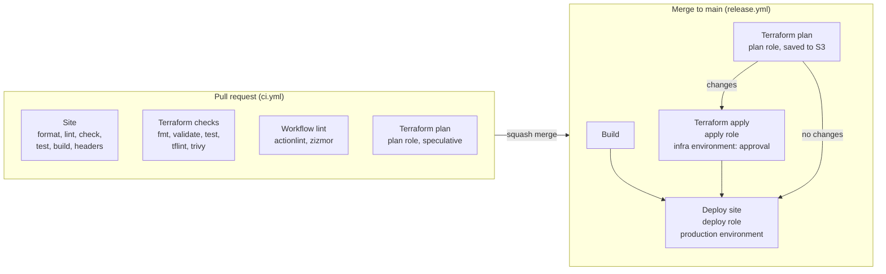

# CI/CD

Two workflows do all the work. `ci.yml` checks every pull request; nothing
it runs can change AWS. `release.yml` runs on every merge to `main`: it
builds, plans, applies infrastructure changes after your approval, and
deploys the site.

Credentials come from GitHub's OIDC token, exchanged for one of three IAM
roles. There are no access keys anywhere. [`oidc.md`](oidc.md) covers the
roles and their trust policies.



## Pull requests

| Job                | Runs                                                                    | Credentials |
| ------------------ | ----------------------------------------------------------------------- | ----------- |
| `Site`             | `format:check`, `lint`, `check`, `test`, `build`, `headers:check`       | none        |
| `Terraform checks` | `scripts/infra-check.sh`, the same as `npm run infra:check`             | none        |
| `Workflow lint`    | actionlint (with shellcheck over every `run:` block) and zizmor         | none        |
| `Terraform plan`   | `scripts/ci/terraform-plan.sh` on `infra/main`, without taking the lock | plan role   |

These four job names are the required status checks in the `main` ruleset.

**The plan is never printed.** Job logs on a public repository are public, and
a plan's values include ARNs (which carry the account ID) and the budget
alert address. The script writes the diff to a temporary file and puts only
resource addresses and actions in the job summary. `mask-aws-account-id`
masks the account ID in the rest of the log as a second layer.

**Forks and Dependabot skip the plan.** Neither gets secrets or an OIDC token
on `pull_request`. Their changes are planned again on `main` before any apply,
so nothing reaches AWS unplanned.

## Releases

On every push to `main`:

1. **Build** builds the site, checks `headers.json` against it and keeps the
   output as an artifact. The deploy ships exactly this build.
2. **Terraform plan** plans `infra/main` with the state lock, and uploads the
   saved plan to `s3://<state bucket>/plans/<run>-<attempt>/tfplan`. Not a
   GitHub artifact: those are downloadable by anyone on a public repository.
3. **Terraform apply** runs only if the plan has changes. It waits in the
   `infra` environment for your approval: read the plan summary on the run
   page, then approve or reject. It applies the saved plan, never a fresh one,
   and deletes it afterwards. Unapproved plans expire after 7 days.
4. **Deploy site** runs after the apply, or straight after the plan when there
   is nothing to apply. A failed or rejected apply blocks it.

Apply goes first because the site can depend on it: the CSP's font hashes
live in the CloudFront headers policy, so pages built with new fonts need
the new policy. Posts no longer change the CSP; only the font configuration,
or Google updating the font files, does.

### What the deploy sets

`scripts/deploy.sh` uploads in three passes, assets first and HTML last, so a
page fetched mid-deploy never references a file that is not there yet.

| Files           | `Cache-Control`                                     | Why                                                                       |
| --------------- | --------------------------------------------------- | ------------------------------------------------------------------------- |
| `/_astro/*`     | `public, max-age=31536000, immutable`               | Names are content hashes: a changed file is a new file                    |
| everything else | `public, max-age=0, s-maxage=3600, must-revalidate` | Browsers revalidate each visit (a 304); the edge keeps it an hour at most |

HTML also gets `Content-Type: text/html; charset=utf-8`. Then the whole
distribution is invalidated (`/*` counts as one path; 1,000 a month are free)
and the job waits for the invalidation to finish, so a green deploy means the
new site is live.

Old `/_astro/*` files are not deleted: a browser holding the previous HTML
may still ask for them. They are small, and bucket versioning would keep them
for 30 days anyway.

## Rolling back

**The site or the infrastructure:** revert the merge commit on a branch and
merge the revert PR. The release runs as usual, and an infrastructure revert
goes through the same approval.

```sh
git switch main && git pull
git switch -c revert/<what>
git revert <merge commit>
git push -u origin revert/<what>   # then open and merge the PR
```

**Faster, site only:** re-run an earlier successful Release run from the
Actions tab ("Re-run all jobs"). It rebuilds and redeploys that commit. Its
plan is taken against that older commit too, so if infrastructure changed
since, it proposes undoing that - reject the apply, and the deploy is
blocked. In that case use the revert.

**Break-glass, from a laptop**, with credentials for the bucket and
distribution:

```sh
git switch <good commit> && npm ci && npm run build
SITE_BUCKET=<bucket> DISTRIBUTION_ID=<id> scripts/deploy.sh
```

## GitHub setup

Done once. The order matters where noted.

**1. Repository variables and secrets.** `AWS_REGION` and the three
`AWS_ROLE_*` secrets already exist from the OIDC setup ([`oidc.md`](oidc.md)).

```sh
gh variable set TF_STATE_BUCKET --body "<state bucket>"
gh variable set SITE_BUCKET --body "<site bucket>"
gh variable set CLOUDFRONT_DISTRIBUTION_ID --body "$(terraform -chdir=infra/main output -raw distribution_id)"
gh variable set SITE_URL --body "https://<domain>"
gh secret set MAIN_TFVARS < infra/main/terraform.tfvars
```

`MAIN_TFVARS` is the whole `terraform.tfvars`, so CI plans with exactly the
values you would locally. **After editing the local file, set it again**, or
CI keeps planning with the old values.

**2. The `infra` environment.** Main only, and you as required reviewer.
Self-review must stay allowed: on a solo repository you are both the person
who triggers the run and the only reviewer.

```sh
gh api --method PUT repos/<owner>/<repo>/environments/infra --input - <<EOF
{
  "reviewers": [{ "type": "User", "id": $(gh api user --jq .id) }],
  "prevent_self_review": false,
  "deployment_branch_policy": { "protected_branches": false, "custom_branch_policies": true }
}
EOF
gh api --method POST repos/<owner>/<repo>/environments/infra/deployment-branch-policies \
  -f name=main -f type=branch
```

`production` needs no reviewer: merging a PR is the decision to publish.

**3. Require pinned actions.** Every `uses:` here is a full commit SHA; this
makes GitHub refuse any that is not.

```sh
gh api --method PUT repos/<owner>/<repo>/actions/permissions \
  -F enabled=true -f allowed_actions=all -F sha_pinning_required=true
```

**4. The `main` ruleset - after the CI jobs have run once.**
[`.github/rulesets/main.json`](../.github/rulesets/main.json) blocks direct
pushes, force-pushes and deletion, requires a squash-merged PR, and requires
the four CI jobs to pass. It has no bypass, admins included.

```sh
gh api --method POST repos/<owner>/<repo>/rulesets --input .github/rulesets/main.json
```

A required check only takes effect once a job with that exact name has
reported, which is why this comes after the first CI run. Renaming a job in
`ci.yml` means updating the ruleset to match, or every PR waits forever for a
check that no longer exists.

## Dependabot

Weekly, grouped PRs for actions, npm packages and Terraform providers
(`.github/dependabot.yml`). A release must be 14 days old before it is
proposed, so a hijacked or broken version has time to be pulled first. Each
PR runs the full CI except the plan.

## Running the same checks locally

```sh
npm run format:check && npm run lint && npm run check && npm test
npm run build && npm run headers:check
npm run infra:check
npm run lint:workflows      # actionlint + zizmor
```

actionlint is in `.tool-versions`. zizmor has no asdf plugin; install the
release binary and verify its build attestation:

```sh
gh release download v1.30.1 --repo zizmorcore/zizmor \
  --pattern 'zizmor-x86_64-unknown-linux-gnu.tar.gz' --dir /tmp/zizmor
gh attestation verify /tmp/zizmor/zizmor-x86_64-unknown-linux-gnu.tar.gz --repo zizmorcore/zizmor
tar -xzf /tmp/zizmor/zizmor-x86_64-unknown-linux-gnu.tar.gz -C ~/.local/bin zizmor
```

## Troubleshooting

| Symptom                                                   | Cause and fix                                                                                                                            |
| --------------------------------------------------------- | ---------------------------------------------------------------------------------------------------------------------------------------- |
| `Not authorized to perform sts:AssumeRoleWithWebIdentity` | The token subject does not match the role. See the table in [`oidc.md`](oidc.md#troubleshooting)                                         |
| `MAIN_TFVARS is not set`                                  | The secret is missing, or the run is a fork or Dependabot PR (which should have skipped the plan)                                        |
| Plan shows changes nobody made                            | `MAIN_TFVARS` differs from your local `terraform.tfvars`, or something changed in the console. Set the secret again, or revert the drift |
| `Saved plan is stale`                                     | State changed between plan and apply (a local apply, say). Re-run the workflow for a fresh plan                                          |
| `Error acquiring the state lock`                          | Another plan or apply holds it. Wait; if a run died holding it, `terraform force-unlock <id>` locally                                    |
| Apply job waiting                                         | That is the gate. Review the plan summary, then approve in the run page                                                                  |
| Deploy skipped                                            | The apply failed or was rejected. Nothing was published                                                                                  |
| `headers:check` fails with no change of yours             | Google updated the font files, changing the `<style>` hashes. Run `npm run build && npm run headers` and commit `config/headers.json`    |
| `Inline style attributes in the build`                    | A component or plugin emits `style=""`, which the CSP blocks. Use a class                                                                |
