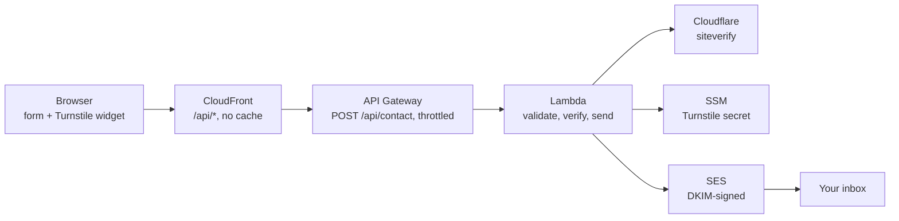

# Contact form

The form on `/contact/` posts JSON to `/api/contact`. CloudFront routes that
path to an API Gateway HTTP API, which invokes the `portfolio-contact` Lambda
([`api/contact/`](../api/contact)). The Lambda validates the message, checks
the Cloudflare Turnstile token and sends the email through SES.
[`infra/main/contact.tf`](../infra/main/contact.tf) defines all of it except
the Turnstile secret, which is the one value that never goes through
Terraform.



## The Turnstile secret is not in the infrastructure code

Terraform writes every value it manages into its state file in plain text,
`SecureString` parameters included. If Terraform created the secret, anyone
who can read the state bucket could read the secret too, and so could every
plan job that loads that state. So the parameter is created by hand, once,
outside Terraform:

- **Terraform knows only its name** (`turnstile_secret_parameter_name`,
  default `/portfolio/turnstile-secret`). It passes the name to the Lambda and
  grants the Lambda role `ssm:GetParameter` on that parameter, plus
  `kms:Decrypt` scoped to it.
- **The Lambda reads the value at runtime** and keeps it for 5 minutes
  (`SECRET_MAX_AGE_MS` in [`secret.ts`](../api/contact/src/secret.ts)).
- **It is in no file, no tfvars, no GitHub secret and no log.**

The **site key** is a different matter. It is public by design, since it is
written into the page's HTML. It lives in the `PUBLIC_TURNSTILE_SITE_KEY`
repository variable, and the release build fails without it rather than
shipping Cloudflare's test key.

## Setup

Done once, before the first apply that creates the contact stack.

**1. Turnstile widget.** Create a free Cloudflare account, then go to
Turnstile → Add widget:

| Setting       | Value                            |
| ------------- | -------------------------------- |
| Name          | `portfolio contact`              |
| Hostname      | the site's domain, and only that |
| Widget mode   | Managed                          |
| Pre-clearance | No                               |

Cloudflare shows a site key and a secret key.

**2. The secret, into SSM.** `read -rs` keeps it off the screen, out of shell
history and out of any file:

```sh
read -rs TS_SECRET && aws ssm put-parameter --region <aws_region> \
  --name /portfolio/turnstile-secret --type SecureString \
  --value "$TS_SECRET" && unset TS_SECRET
```

Paste the secret key at the silent prompt and press Enter.

**3. The site key, into GitHub.**

```sh
gh variable set PUBLIC_TURNSTILE_SITE_KEY --body '<site key>'
```

**4. The recipient.** Add `contact_recipient_email` to
`infra/main/terraform.tfvars` (git-ignored), then upload the file again:

```sh
gh secret set MAIN_TFVARS < infra/main/terraform.tfvars
```

The sender defaults to `contact@<domain>`. Terraform verifies the domain in
SES and creates its three DKIM records in Route 53, so the sender needs no
setup. Nothing receives mail at that address; replies go to the visitor
through `Reply-To`.

**5. SES sandbox.** A new SES account can only send to verified addresses.
Check, and if it prints `false`, verify the recipient and click the link in
the email that arrives:

```sh
aws sesv2 get-account --region <aws_region> --query ProductionAccessEnabled
aws sesv2 create-email-identity --region <aws_region> --email-identity '<recipient>'
```

## Rotating the Turnstile secret

Rotate if the secret may have leaked, and otherwise whenever you like. Nothing
is redeployed, and the site key does not change.

1. In Cloudflare, open the widget → Settings → **Rotate Secret Key**. For the
   next two hours both the old and the new secret are accepted.
2. Within those two hours, overwrite the parameter:

   ```sh
   read -rs TS_SECRET && aws ssm put-parameter --region <aws_region> \
     --name /portfolio/turnstile-secret --type SecureString --overwrite \
     --value "$TS_SECRET" && unset TS_SECRET
   ```

3. Wait 5 minutes. Every running Lambda re-reads the parameter at most 5
   minutes after it last read it, so by then all of them use the new secret.
4. Send a test message from the live form and check that it arrives:

   ```sh
   aws logs tail /aws/lambda/portfolio-contact --region <aws_region> --since 10m
   ```

If the form reports that the spam check failed after the two hours, a Lambda
is still using the old secret. Check that the parameter holds the new one,
without printing it:

```sh
aws ssm get-parameter --region <aws_region> --name /portfolio/turnstile-secret \
  --query Parameter.LastModifiedDate
```

## Locally

No Cloudflare account or AWS access is needed. `npm run dev` uses Cloudflare's
test keys, which always pass, and prints the email instead of sending it.
[`api/contact/.env.example`](../api/contact/.env.example) lists the test
secrets that always fail, to see the error paths.
